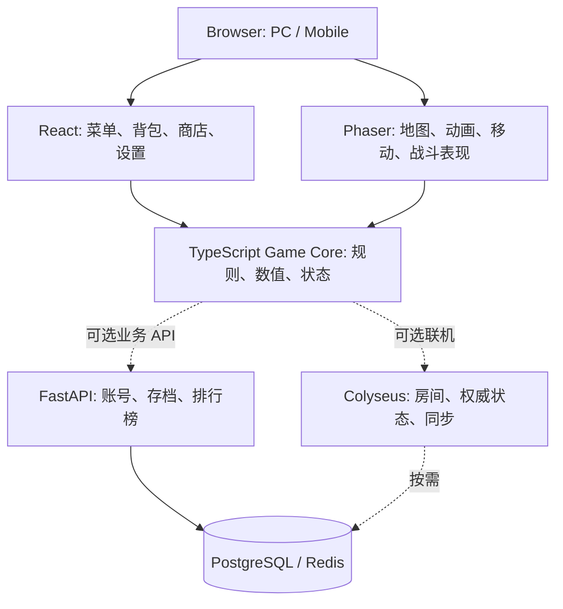
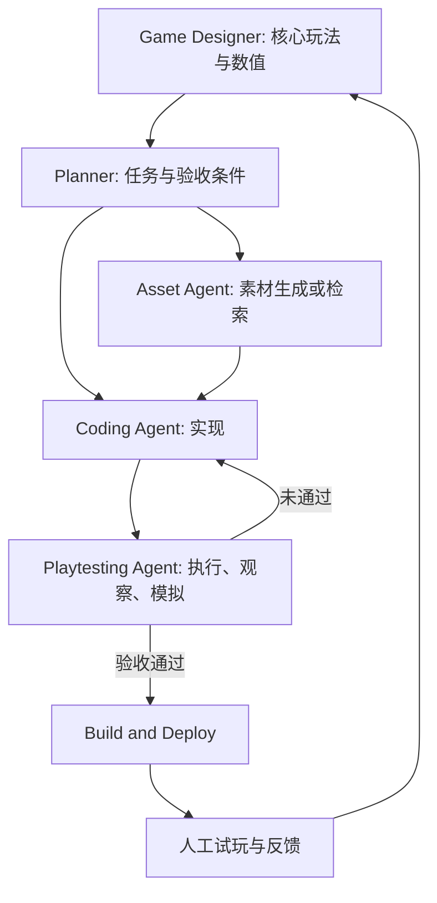

# 网页游戏开发与 AI 自动化生产指南

整理日期：2026-11-26

## 1. 目标与原则

面向个人开发者，利用成熟游戏引擎、TypeScript、现成素材、Coding Agent（Codex / Claude Code）和自动化测试，快速验证创意、发布网页游戏，并逐步沉淀可复用的生产工具。

- 不重复实现渲染、物理、碰撞、动画、资源加载等基础设施。
- 将游戏规则和数值逻辑与渲染分离，优先做到可独立测试、可模拟。
- 单机 MVP 优先静态部署；真实需求出现后再添加后端、数据库、联机及集群。
- 先完成第一款可玩的游戏，再从真实项目提取通用模块，不要提前造一个大而全的游戏引擎。

## 2. 框架选型

| 框架 | 适合类型 | Agent 适配度（定性） | 学习/开发门槛 | 官方资源 |
|---|---|---|---|---|
| Phaser | 2D RPG、塔防、横版、肉鸽 | 极高 | 低 | https://phaser.io/ |
| React + TypeScript | 卡牌、经营、文字、放置 | 极高 | 低 | https://react.dev/ |
| GDevelop | 休闲小游戏、快速原型 | 较高 | 极低 | https://gdevelop.io/ |
| Construct 3 | 2D 休闲游戏 | 中等 | 极低 | https://www.construct.net/ |
| Godot | 中大型 2D/3D、跨平台游戏 | 较高 | 中等 | https://godotengine.org/ |
| PlayCanvas | Web 原生 3D | 高 | 中等 | https://playcanvas.com/ |
| Babylon.js | 复杂 3D 网页游戏 | 高 | 较高 | https://www.babylonjs.com/ |
| Three.js | 定制 3D 渲染与玩法 | 高 | 较高 | https://threejs.org/ |
| Unity | 大型 2D/3D 跨平台项目 | 较高 | 高 | https://unity.com/ |

以上是基于代码可读性、工具链、可测试性和 GUI 依赖的主观选型判断，不是实测 benchmark。Three.js 是渲染库而非完整游戏引擎；React 也不是游戏引擎。

### 2.1 默认 2D 方案：Phaser

已有场景管理、输入、摄像机、物理及碰撞检测、精灵动画、粒子特效、音频、地图和资源加载。官方示例可直接作为 Agent 的实现参考。

```bash
npm create @phaserjs/game@latest
```

选择 Vite + TypeScript（可选 React 模板）。

- 官方示例：https://phaser.io/oss/examples
- 官方文档：https://docs.phaser.io/
- GitHub：https://github.com/phaserjs/phaser

### 2.2 何时直接使用 React

若主要玩法是资源管理、数值计算、卡牌选择、文字冒险或回合制决策，HTML/CSS/SVG/React 足以实现游戏，无需引入 Canvas 或完整游戏引擎。需要实时地图、移动、碰撞及战斗时再引入 Phaser。

### 2.3 何时使用其他引擎

- GDevelop / Construct 3：重视快速原型和可视化编辑，接受 GUI 工作流。
- Godot：计划发布桌面端或移动端；Web 导出需评估浏览器兼容性、加载体积及性能。
- PlayCanvas：优先 Web 3D，使用其引擎及场景编辑能力。
- Babylon.js / Three.js：有更强的 3D 定制需求，接受自己搭建部分游戏系统。
- Unity：团队已有 Unity 经验或跨平台复杂项目；纯 Web 小游戏通常不是首选。

## 3. 现成工具与资源

### 3.1 Agent 工具、MCP 和玩法模块

| 工具 | 用途 | 参考入口 |
|---|---|---|
| Phaser AE | 面向 Agent 的可复用玩法及特效模块；按需选取免费或付费组件 | https://phaser.io/ |
| Phaser Game Agent MCP | 探索 Agent 获取游戏框架知识、模块及开发能力的方式 | https://github.com/phaserjs/phaser-game-agent |
| Phaser Editor MCP | 探索 Agent 操作场景编辑器的能力 | https://phaser.io/oss/docs/phaser-editor/ai/mcp-server |
| PixelLab MCP | 生成像素角色、精灵、动画、地图和道具等美术素材 | https://www.pixellab.ai/mcp |
| Playwright | 浏览器自动化、截图、输入模拟、E2E 测试 | https://playwright.dev/ |
| Colyseus | 多人房间、匹配、权威服务端状态、状态同步 | https://colyseus.io/ |
| Vitest | 游戏核心规则的单元测试及模拟测试 | https://vitest.dev/ |

Phaser AE、Game Agent MCP、Editor MCP 和 PixelLab MCP 属于优先验证的候选项，并非本指南已经安装或实测通过的依赖。采用前核对当前官方文档、版本、模块可用性、商业授权、费用与兼容性。不要将 MCP 作为 MVP 的硬依赖。Phaser AE 可重点寻找三消、卡牌、粒子与魔法、地形、标题界面、物理等现成模块，实际覆盖范围以官方目录为准。

### 3.2 美术、地图、音效和模板

| 资源 | 说明 |
|---|---|
| [Kenney](https://kenney.nl/assets) | 角色、地图、UI、音效、3D 模型等，素材通常为 CC0，逐包核对许可 |
| [itch.io Game Assets](https://itch.io/game-assets) | 免费与付费独立游戏素材和模板，每个资源授权不同 |
| [Tiled](https://www.mapeditor.org/) | 开源地图编辑器，支持 JSON 等格式，适合 RPG、塔防和横版 |
| [Phaser Examples](https://phaser.io/oss/examples) | 大量示例，优先复用场景、碰撞、动画等实现方式 |

建立资产清单，记录来源、许可证、作者、是否允许商用及再分发、生成模型或工具；不将第三方付费素材无授权提交到公共仓库。统一像素尺寸、色板、视角和动画帧规格，避免 AI 生成素材风格不一致。

## 4. 推荐技术架构



| 模块 | 建议 |
|---|---|
| 引擎 | Phaser（需要实时 2D 时） |
| 页面 UI | React + Tailwind CSS |
| 语言 | TypeScript |
| 构建 | Vite |
| 状态管理 | Zustand（按需），核心规则保持独立 |
| 单机存档 | IndexedDB（简单游戏可用 localStorage） |
| 业务后端 | Python FastAPI（按需） |
| 数据库 | PostgreSQL；Redis 按需用于缓存或临时数据 |
| 实时多人 | Colyseus / Node.js |
| 单元测试 | Vitest |
| 浏览器测试 | Playwright |
| 部署 | 静态网站托管；有后端后使用 Docker / Nginx，按规模再考虑 K8s |

### 4.1 核心边界

- Game Core 不依赖 DOM、React 或 Phaser，负责命令、状态变更、战斗、掉落、技能、经济、任务等规则。
- Phaser 接收状态及事件并渲染，处理输入但不独立拥有核心规则；React 通过明确接口读取 UI 所需状态。
- 随机数可注入 seed，时间可注入 clock；便于重放和测试。避免渲染 FPS 影响核心计算。
- 存档需要 schema version、迁移逻辑及错误处理。
- 多人或有竞争性排行榜时，服务端验证玩家操作，不能信任浏览器计算的分数和经济状态。
- 初期不必同时使用 FastAPI 和 Colyseus。若需要共享 TypeScript 核心规则，可优先 Node.js/Colyseus；Python 后端通过 API 集成。

## 5. AI Agent 自动化开发流程



不一定需要多个运行中的 Agent；同一个 Coding Agent 可以通过不同 Skills 切换职责。

| 角色 | 输入 | 输出 |
|---|---|---|
| Game Designer | 创意、目标玩家、限制条件 | 核心循环、规则、数值、非目标 |
| Planner | 游戏设计文档 | 小任务、依赖、验收标准 |
| Coding Agent | 任务、代码、框架文档 | 实现、测试、提交 |
| Asset Agent | 风格指南、尺寸及授权要求 | Sprite sheet、地图、UI、音效及资产清单 |
| Playtesting Agent | 构建、测试场景、验收标准 | 测试记录、截图、数值/性能报告、缺陷 |
| Release | 已验收的构建 | 可访问版本、版本记录、回滚方案 |

### 5.1 测试闭环

- 单元测试：规则、伤害、冷却、掉落、库存、存档和状态转换。
- 无渲染数值模拟：用固定 seed 执行大量战斗/经济循环，统计胜率、资源通胀、成长曲线及极端情况。
- Playwright：启动游戏，模拟鼠标/键盘/触屏操作，检查状态、控制台报错、加载错误。
- 视觉测试：在固定时间步和 seed 下截图，对照基线检查布局、遮挡、角色位置和响应式画面。
- 性能测试：记录指定设备和场景中的帧率、帧耗时分位数、加载时间及内存趋势；设定与目标设备对应的预算。
- 自动修复：复现问题 → 修改 → 重跑相关测试 → 完整回归。设置迭代次数/时间/成本上限，失败时输出证据。
- 人工试玩：游戏是否好玩、节奏、难度、公平性等仍需要真实玩家反馈，不能仅由测试通过判定。

建议仅在开发构建暴露测试接口（例如读取游戏状态、注入 seed、推进时间、执行游戏命令），生产环境禁用调试入口。

### 5.2 Agent Goal 示例

目标：交付可通过浏览器直接试玩的单关卡塔防 MVP。

验收：
1. 玩家可以开始、建造/升级塔、抵御敌人、看到胜负结果并重新开始。
2. 核心规则有单元测试，主要交互有 Playwright 测试。
3. 固定 seed 可重复模拟；测试失败可复现。
4. PC 和目标移动端视口无关键 UI 遮挡；无阻塞性控制台错误。
5. 构建通过，提供试玩入口/本地启动命令、素材许可证和已知限制。

非目标：账号、联机、付费系统、完整编辑器、自研引擎。Agent 可以自主拆分任务和修复问题，但不得擅自引入付费服务或发布未经授权的资产。

## 6. 长期复用：Game Starter Kit

建议先在第一款游戏内部开发，之后根据多个项目的共同需求抽取：

```text
game-starter-kit/
├── packages/
│   ├── game-core/
│   ├── combat-system/
│   ├── inventory-system/
│   ├── economy-system/
│   ├── skill-system/
│   ├── quest-system/
│   ├── save-system/
│   └── ui-components/
├── assets/
│   ├── characters/
│   ├── tilesets/
│   ├── icons/
│   └── audio/
├── templates/
│   ├── tower-defense/
│   ├── roguelike/
│   ├── idle-game/
│   └── card-game/
├── skills/
│   ├── game-design/
│   ├── game-development/
│   ├── asset-generation/
│   ├── game-balancing/
│   └── game-testing/
├── tests/
└── AGENTS.md
```

此处为未来目录建议，不表示已创建代码或 Skills。每个复用模块应有明确接口、示例、测试、版本及兼容性说明。先抽取存档、可注入随机数、规则测试和 UI 通用件；战斗及经济等系统有两个实际用例之后再考虑抽象。

## 7. 第一款游戏选型

| 类型 | 开发成本 | 美术成本 | AI 开发适配度（定性） |
|---|---|---|---|
| 放置挂机 | 极低 | 极低 | 5/5 |
| 文字经营模拟 | 极低 | 极低 | 5/5 |
| 卡牌构筑 | 低 | 低 | 5/5 |
| 塔防 | 低 | 中 | 5/5 |
| 类吸血鬼幸存者 | 低 | 中 | 5/5 |
| 2D 回合制策略 | 中 | 中 | 4/5 |
| 2D 开放世界 RPG | 高 | 高 | 3/5 |
| 3D 生存 | 高 | 高 | 3/5 |
| MMORPG | 极高 | 极高 | 2/5 |

评分为对有限范围 MVP 的定性判断，具体复杂度随内容和联机要求变化。首选放置经营、卡牌、塔防或肉鸽生存。放置/经营/卡牌可以从 React 开始；塔防/动作肉鸽从 Phaser 开始。

## 8. 实施路线

- [ ] 选择一个游戏类型，写一页设计文档（核心循环、胜负、玩家决策、范围）。
- [ ] 用官方模板创建 TypeScript + Vite 项目，必要时加入 Phaser/React。
- [ ] 先用占位素材完成可玩的 vertical slice，加入核心规则单元测试。
- [ ] 建立 Playwright 启动、操作、截图和回归流程。
- [ ] 试用 Kenney 等现成素材；小范围验证 PixelLab MCP 与 Phaser Agent 工具的价值。
- [ ] 加入本地存档、基础设置和移动端适配。
- [ ] 发布静态试玩版本，收集真实反馈。
- [ ] 按实际需求引入后端、联机、监控；逐步沉淀 Starter Kit 与 Skills。

## 9. 总结

默认技术栈：Phaser + TypeScript + Vite + React（按需）+ Vitest + Playwright。Codex / Claude Code 通过文档、示例、Skills 和测试闭环开展工作；Phaser AE、PixelLab MCP 等是潜在加速器，应先做小规模 PoC 再纳入生产流程。

本指南是技术选型和开发流程记录，不是已经搭建或部署的游戏项目；未执行框架、MCP 或性能 benchmark。后续 Agent 应根据具体游戏类型、设备目标、预算和授权要求调整方案。
