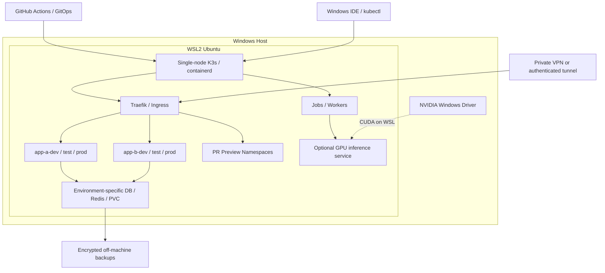

# 个人多业务开发平台：Windows + WSL2 + K3s

> 日期：2026-11-25 | 状态：建议采纳，待本机 PoC 验证，未部署
> 范围：个人多业务、Dev/Test/Prod、并行 Coding Agent、CPU/GPU 计算任务。
> 本文为基础设施设计，不是业务代码。标记：[原文] 官方资料；[工程] 实施约束；[推断] 初始设计预算/选型，须实测调整。
> 与 [ADR-002 环境隔离与发布流程](../frontend/decisions/ADR-002-环境隔离与发布流程.md) 互补：保留其发布审批、SEO 和数据隔离规则；K3s 是自托管服务的部署目标，并不强制将适合 Cloudflare Workers/CDN 的静态网站迁入本机。

## 1. 决策与目标

[推断] 首期一台物理电脑、一个 WSL2 Ubuntu 24.04 LTS、一个单节点 K3s。每个业务每个环境一个 Namespace；共享入口、镜像仓库、基础设施，按需开关非生产环境。业务容器使用 Linux OCI 镜像，业务独立仓库，平台配置未来独立私有 infra repo。不要先装 Service Mesh、Longhorn、多节点 etcd、完整 GPU Operator 或自研 PaaS。

目标：新增业务时不重复设计部署、域名、证书、测试、回滚和资源配额；能同时运行轻量 Web/API、异步任务与实验性 GPU 服务。不是高可用生产云，不承诺并发数量或 SLA。若只是几个静态站点，保留托管/CDN 的低成本选择。

## 2. 硬件与预算

| 项 | 配置 |
|---|---|
| CPU | Intel Core i5-13600K，6P+8E，14 核 20 线程 |
| RAM | 64 GB |
| GPU | RTX 4090，24 GB VRAM |
| Host | Windows（版本尚未确认，建议受支持的 Windows 11） |
| Disk | 容量、类型未知；建议 SSD，先检查可用空间和备份介质 |

[推断] 初始 WSL 上限 48 GiB / 16 个逻辑处理器 / 8 GiB swap；非独占，不是物理核绑定。保留 Windows 16 GiB 预算，K3s 内预算如下（GiB）：

| 池 | 内存预算 | CPU requests 预算（核） |
|---|---:|---:|
| OS/K3s/入口等平台 | 4 | 2 |
| Prod（含生产数据服务） | 16 | 5 |
| Dev/Test/Preview（含测试数据服务） | 12 | 3 |
| AI/批任务 | 12 | 4 |
| 余量 | 4 | 2 |
| 总计 | 48 | 16 |

CPU/内存预算是规划参考，不等于可直接配置的 namespace quota；应先看 Node Allocatable，扣掉系统及运行组件实际开销，再把 requests/limits 分配到各 namespace，给生产留余量。GPU VRAM 与 RAM 独立，不能把 24GB 显存计作可用内存。若平时游戏、IDE 或 Windows 大负载，降低 WSL/任务预算。磁盘初期建议至少 200GB 可用（视镜像/模型/数据库调整，尚未确认），告警阈值 80%，避免 VHDX 撑满宿主磁盘。

## 3. 架构



[工程] 物理电脑是共同故障域：Windows 更新、休眠、断电、磁盘损坏、WSL 停止会影响所有环境；多个虚拟节点并不能提供物理 HA。K3s 运行在 Linux 内，使用内置 containerd，不必安装 Docker Desktop；若已有 Docker Desktop/其他集群，核查端口与 kubeconfig context 避免冲突。

## 4. 环境与资源治理

| 环境 | 触发 | 生命周期 | 访问 | 数据 |
|---|---|---|---|---|
| local | 本地开发/worktree | 按需 | localhost | 本地 |
| dev | feature/dev 分支或手工 | 按需 | 私有 | 假数据 |
| test/staging | PR 集成或 main 合并 | 按需或共享常驻 1 副本 | 私有/认证 | 独立测试库 |
| preview | PR label 或手工 | PR 关闭/TTL 回收 | 私有/认证 | 临时数据 |
| prod | 测试通过 + 人工审批 | 常驻 | 视业务公开 | 真实数据 |

Namespace 命名：app-a-dev、app-a-test、app-a-prod、app-a-pr-123；平台命名 infra-system、ai-compute 等。环境配置用 Kustomize base + overlays（dev/test/prod）；preview 从 test overlay 派生，域名、数据卷、Secret 唯一。命名和标签包含 app、env、owner、release SHA。每业务每环境单独 ServiceAccount、DB 用户和数据库；初期可共享 PostgreSQL 实例但生产/非生产优先分实例，绝不共享生产凭证；Redis 如存敏感数据或需要隔离，使用独立实例或受限 ACL，不能只依赖 DB 编号隔离。

[工程] 每 namespace 设置 ResourceQuota、LimitRange、显式 CPU/memory requests/limits；用 PriorityClass（限制非生产使用）优先保障生产 Pod 调度，不把优先级当作硬资源预留。默认拒绝网络 ingress/egress，再允许 DNS、必要的入口、数据库和外部依赖。Pod Security restricted（按实际组件设置并测试必要例外）、非 root、禁止 privileged/hostPath/hostNetwork、最小权限 RBAC。生产凭证绝不交给 Coding Agent；高风险或不可信代码放独立 VM/远程沙箱，而不是把 Namespace 当安全边界。非生产服务 scale-to-zero 时，数据库、PVC、CronJob 不会自动停止，须单独管理。测试压测与 GPU 任务并发必须有上限。

## 5. Windows / WSL2 初始化（实施手册）

[原文] Microsoft WSL 配置与 systemd：[配置](https://learn.microsoft.com/en-us/windows/wsl/wsl-config)、[systemd](https://learn.microsoft.com/en-us/windows/wsl/systemd)、[网络](https://learn.microsoft.com/en-us/windows/wsl/networking)。K3s [安装要求](https://docs.k3s.io/installation/requirements)。

1. 确认 BIOS VT-x、Windows 虚拟化支持、管理员权限和磁盘；PowerShell 执行 `wsl --update`、`wsl --list --online`、`wsl --install -d Ubuntu-24.04`（已安装则不重复），`wsl -l -v` 确认 WSL 2。若需要重启，先正常重启。
2. 在 Windows 用户目录 `%USERPROFILE%\.wslconfig` 写入（全局 WSL2 资源上限，不是单 distro 独占）：

```ini
[wsl2]
memory=48GB
processors=16
swap=8GB
# Windows 11 22H2+ 且兼容时可启用：
# networkingMode=mirrored
```

3. Ubuntu 检查 `ps -p 1 -o comm=`。若不是 systemd，在 /etc/wsl.conf 合并以下配置，不覆盖已有设置；保存工作后在 PowerShell 执行 `wsl --shutdown`，再进入 Ubuntu。

```ini
[boot]
systemd=true
```

4. 检查 `systemctl is-system-running`、`stat -fc %T /sys/fs/cgroup`、`free -h`、`nproc`、`df -h`。K3s 需要可用 cgroups 等内核功能；若 WSL 网络/cgroups 不兼容，先修复再部署，或改用 Linux VM/裸机。
5. 安装 K3s：先审阅官方安装脚本与 release，选定受支持的具体版本并记录到私有 infra repo（以下占位需替换）。采用默认 SQLite、Traefik、ServiceLB、local-path；开启 Secrets at-rest encryption。

```bash
sudo install -d -m 0755 /etc/rancher/k3s
# /etc/rancher/k3s/config.yaml:
# secrets-encryption: true
# write-kubeconfig-mode: "0600"
curl -fsSLo /tmp/k3s-install.sh https://get.k3s.io
# 审核脚本并设置具体版本后执行：
INSTALL_K3S_VERSION='<PINNED_K3S_VERSION>' sh /tmp/k3s-install.sh
sudo systemctl enable k3s
sudo k3s kubectl get nodes -o wide
sudo k3s kubectl get pods -A
sudo k3s kubectl describe node
```

配置应实际写入 YAML 后再安装；不使用浮动版本进行可重复部署。默认 kubeconfig 在 /etc/rancher/k3s/k3s.yaml，权限 0600；本机通过 WSL kubectl 管理，后续按需生成受限凭证。不要把 admin kubeconfig 提交 Git。版本、插件、镜像 tag/digest 固定；升级前备份并测试。

## 6. 网络、域名与生产可达性

[工程] 先用 `kubectl port-forward` 或本地 hosts + Traefik 验证；生产、dev、test 使用独立域名，示例 app.example.com、dev.app.example.com、test.app.example.com、pr-123.app.example.com。默认 WSL NAT，Windows localhost 访问与 LAN 访问并非一回事；需要 LAN 时优先测试支持的 mirrored mode，或受控的 Windows port forwarding（WSL IP 可能变化）。检查 Windows/Hyper-V 防火墙、端口冲突及重启后可达性。不对公网开放 6443、SSH、数据库、Redis 或管理面板。

远程开发通过私有 VPN（如 Tailscale）或受认证的入口；正式网站可用 Cloudflare Tunnel 等合法可用的出站隧道或云端反向代理（需测试实际线路与所在地区条件），只放行具体业务服务。TLS 可由 Traefik/cert-manager 管理，也可由边缘代理终止，避免重复控制同一证书。staging/preview 强制认证并设置 noindex；prod 不带 noindex，正式域名检查遵循 ADR-002。若无稳定域名/网络，先做私有测试，不承诺公开上线。

WSL systemd 服务本身不保证 distro 一直运行。[原文] Microsoft systemd 文档有此限制。配置 Windows 电源策略（接电不睡眠、不自动休眠，屏幕可关闭），通过任务计划程序在所属 Windows 用户登录/启动条件满足时启动 Ubuntu，并配置持久前台 keepalive 或支持的 WSL keep-running 机制（以安装版本为准），定期健康探测和故障重启。测试退出终端、锁屏、重启、Windows 更新后的恢复。若无人登录不能可靠启动或不能接受重启窗口，迁移生产到独立 Linux 主机/VPS。禁止用绕过安全更新的方式维持在线。

## 7. GPU：两阶段接入

[原文] NVIDIA [CUDA on WSL](https://docs.nvidia.com/cuda/wsl-user-guide/index.html)；K3s [NVIDIA runtime 配置](https://docs.k3s.io/advanced)；[NVIDIA device plugin](https://github.com/NVIDIA/k8s-device-plugin)。WSL GPU 通过 Windows 驱动提供，NVML 有限制；K3s 设备插件在某些 WSL 组合会初始化失败（[兼容问题示例](https://github.com/NVIDIA/OpenShell/issues/404)）。不能假定 GPU Operator 或插件开箱即用。

阶段 A（推荐先做）：Windows 安装兼容 NVIDIA 驱动，Ubuntu 执行 `nvidia-smi`（必要时 /usr/lib/wsl/lib/nvidia-smi），不要在 WSL 内安装 Linux 内核显卡驱动。先在 WSL 中运行独立推理进程/支持 WSL GPU 的容器，K3s 内业务通过受限私有 HTTP endpoint 访问。用真实 Pod 验证到推理端点的路由、防火墙和认证；Pod 内 localhost 不是宿主机 localhost。服务不可暴露公网，记录并发、显存峰值、OOM 与恢复。先选轻量 embedding、Whisper、合适量化模型，24GB 不保证任意模型可运行。

阶段 B（可选）：安装 WSL 兼容 NVIDIA Container Toolkit；按 K3s 官方版本文档确认 containerd 检测到 NVIDIA runtime，安装兼容 device plugin（检查 WSL NVML/CDI 支持），验证 `kubectl get runtimeclass`、`kubectl describe node` 中 nvidia.com/gpu=1，再运行指定 runtimeClass 和 GPU limit 的 CUDA smoke Job。若失败保留阶段 A，不因插件卡住整体项目；需要稳定原生 GPU 调度时优先迁移裸机 Linux。

示例资源片段（仅在 device plugin 已验证后）：

```yaml
runtimeClassName: nvidia
containers:
  - name: worker
    image: <PINNED_CUDA_WORKER_IMAGE>
    resources:
      requests:
        cpu: "2"
        memory: 4Gi
      limits:
        cpu: "4"
        memory: 8Gi
        nvidia.com/gpu: 1
```

[工程] 单张 4090 初期默认一个 GPU 调度任务或一个共享推理服务，任务队列串行/限并发；不假设 MIG、显存硬隔离或 GPU time-slicing 等于独占隔离。Windows 桌面/游戏也可能占用同一 GPU。优先保证 Web/API 可用，不让批量任务打满宿主机。动态任务优先 asyncio/Celery + queue；独立容器/资源隔离需求再使用 K8s Job、CronJob、TTL、backoffLimit、activeDeadlineSeconds；后续有指标再引入 KEDA。

## 8. CI/CD、GitOps 和 Agent

```text
feature / worktree -> PR CI (lint/unit/build/security scan)
  -> optional preview -> integration tests
  -> main merge -> test/staging deploy -> smoke/E2E
  -> approval -> promote same OCI image digest -> prod smoke -> rollback if needed
```

业务 Git repo 放 Dockerfile 与 deploy/base、deploy/overlays/{dev,test,prod}；私有 infra repo 放 cluster bootstrap、共享组件、各环境期望版本及策略。镜像使用 GHCR，非公开镜像使用受限 pull secret。开发期先从本地 `kubectl apply -k` 验证，再引入 Flux 或 Argo CD（二选一）；优先由集群出站 pull，不让 GitHub-hosted runner 直接访问内网 API，不让不可信 PR 使用常驻且有生产访问权限的 runner。生产环境审批可以由独立人工 GitOps PR/签名 release 实现；若用 GitHub Environments，先核实当前仓库可用的保护规则。发布同一镜像 digest；若环境变量需 build-time 固化则记录不同构建产物及验证证据。DB schema 使用兼容迁移，镜像回滚不等于数据库回滚。

Agent 按角色权限：coding agent 写分支/提 PR；CI 构建、扫描和测试；部署 agent 仅操作授权 dev/test；生产由受控 reconciler + 人工审批；监控 agent 只读。Secret 采用加密存储（如 SOPS + age），密钥另存，禁止真实 Secret、kubeconfig、token 和备份提交公开仓库。Preview PR 关闭回收且设置定时清理；数据卷清理需明确白名单，绝不匹配生产。

## 9. 数据、监控和恢复

| 组件 | 首期 | 后续 |
|---|---|---|
| 数据库 | PostgreSQL + 独立环境 DB/role，生产优先独立实例 | 托管 DB/独立主机 |
| 缓存/队列 | Redis 按需 | 独立服务 |
| 存储 | K3s local-path PVC，Linux ext4/VHDX 内 | 外部 S3/CSI |
| 监控 | kubectl top、日志、外部 uptime 探测 | Prometheus/Grafana/Loki |
| GitOps | 本地 Kustomize + 受控发布 | Flux/Argo CD |

不要把数据库活跃文件放 /mnt/c 等 Windows 挂载目录；VHDX 容量监控也要包含 Windows 磁盘。local-path 仅本地持久化，不是备份或高可用。每日加密异机备份（初期保留 7 日 + 4 周，具体按容量/合规校准），包含 PostgreSQL 逻辑备份/必要时 PITR、应用卷、对象、K3s SQLite datastore 与 server token（另存加密）、配置和恢复密钥。SQLite 可在维护窗口停止 K3s 后一致性复制 /var/lib/rancher/k3s/server/db/，按 [K3s 官方恢复流程](https://docs.k3s.io/datastore/backup-restore) 保留 token；数据卷需独立备份。WSL export 仅作为停机后的补充备份，不代替应用一致性备份。至少每月异地恢复演练；初始目标 RPO ≤24h、RTO ≤4h，均需实测，未达到则记录缺口。敏感数据按业务合规加密/访问控制。

监控指标：主机及 WSL 内存、CPU、磁盘、Pod OOM/restarts、HTTP 错误/延迟、任务队列深度、GPU 显存、备份最近成功时间。初期可用 80% 持续资源占用告警，按实测校准。至少一个外部 uptime probe 才能在整台机器掉线时告警。

## 10. 分阶段实施与验收（全部待验证）

| ID | 阶段 | 可判定的通过标准 |
|---|---|---|
| INF-01 | WSL | WSL2 + systemd + cgroups 正常；内存/CPU 上限正确；Windows 日常负载仍可用 |
| INF-02 | K3s | Node Ready；系统 Pod 正常；部署 nginx demo；重启后恢复 |
| INF-03 | 环境 | 同一 demo 部署 dev/test/prod，域名/配置不同；测试账号不能读 prod secret，跨 namespace 非授权网络请求失败 |
| INF-04 | 资源 | dev 超 quota 被拒；批任务与内存压力测试时 prod smoke 不失败；基线延迟留档 |
| INF-05 | 发布 | PR→test→人工审批→同 digest prod；失败可回滚；preview 清理不删除 prod |
| INF-06 | 网络 | Windows 本机及私有远端访问成功；公网无法访问 API/DB；非生产认证与 noindex 生效 |
| INF-07 | GPU A | WSL CUDA smoke + 真实 Pod 调用推理 API 成功；压力/失败不会拖垮 prod |
| INF-08 | GPU B（可选） | device plugin 可用；GPU Job 能执行且资源归还；不通过时记录兼容问题并留在 A |
| INF-09 | 数据 | 从异机备份恢复 DB/PVC/配置到隔离环境，记录 RPO/RTO |
| INF-10 | 稳定性 | 连续运行 72h，测试锁屏、关闭终端、主机重启与外部告警；记录不可用时长 |

实施顺序：INF-01→02→03→04→05→06→07→09→10；INF-08 后置。未通过 INF-03/04/06/09/10 不开放重要真实用户生产服务。先用一个 demo 跑通，再复制到第二业务。具体部署代码和实施记录存私有 infra repo，本文件只做标准、方案和验收。

## 11. 迁移与退出条件

[推断] 以下任何一个条件长期出现，考虑将生产迁移到独立 Linux VPS/服务器：主机重启不可接受、真实用户/付费业务需要 SLA、网络不可靠、磁盘/内存长期饱和、开发测试与生产冲突、不可信 Agent 执行、数据合规要求、GPU/CPU 争用。迁移顺序：创建新集群 → 同 GitOps manifests 重新部署 → 备份恢复/增量同步数据库 → 测试 → 切换 DNS/入口 → 保留回滚窗口。PVC 数据不可假定跨节点自动迁移。可保留家中 4090 作为私有 GPU 计算节点/独立推理 API，云端业务经私有网络调用，必要时异步降级。若需要真正 HA，使用独立物理故障域、控制面 quorum、持久化与负载均衡；单机上多个 VM 不算 HA。

## 12. 待确认事项

- Windows 版本与 WSL 当前安装状态、BIOS 虚拟化、SSD 空间、是否长期在线、外部网络及域名条件。
- GPU 实际需要的模型、并发和 WSL runtime/plugin 版本组合。
- 业务数量、流量、数据敏感度、RPO/RTO 和生产 SLA。
- 是否建立独立私有 infra repo、备份目的地及远程访问方式。

文档未执行安装命令，未测试本机硬件、网络、GPU 或集群；预算和版本策略是初始设计。官方资料链接仅说明各组件能力，不代表本机组合获得生产级支持。
